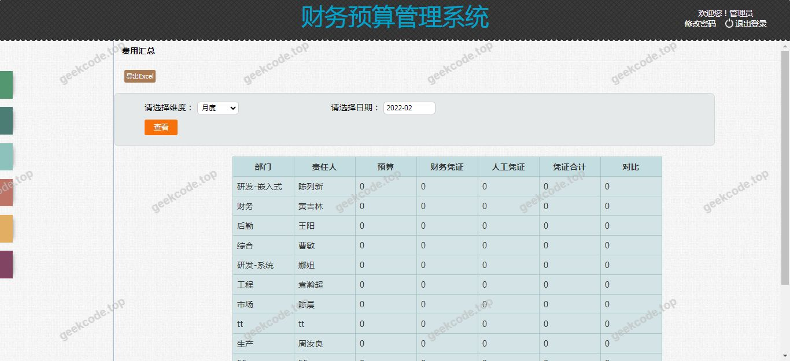
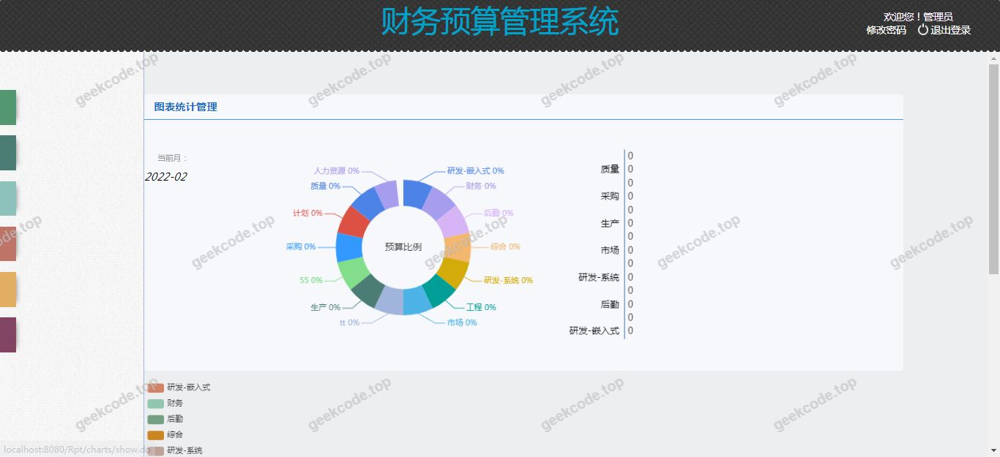

# java精品项目-基于ssm的财务预算管理系统

> 🎓 **计算机毕业设计 · java精品项目-基于ssm的财务预算管理系统**
>
> 本仓库只放**项目介绍 + 运行截图**（截图是站点带水印的原图，存在仓库 `images/` 里）。
>
> 👉 **完整可运行源码 / 数据库脚本 / 部署文档：[点我获取](https://geekcode.top/archives/java%E7%B2%BE%E5%93%81%E9%A1%B9%E7%9B%AE-%E5%9F%BA%E4%BA%8Essm%E7%9A%84%E8%B4%A2%E5%8A%A1%E9%A2%84%E7%AE%97%E7%AE%A1%E7%90%86%E7%B3%BB%E7%BB%9F?utm_source=github)**
>
> 💬 咨询微信：**ir9372**　|　🌐 更多项目：[极客代码 geekcode.top](https://geekcode.top/?utm_source=github)
>
> 📌 项目详情页：<https://geekcode.top/archives/java%E7%B2%BE%E5%93%81%E9%A1%B9%E7%9B%AE-%E5%9F%BA%E4%BA%8Essm%E7%9A%84%E8%B4%A2%E5%8A%A1%E9%A2%84%E7%AE%97%E7%AE%A1%E7%90%86%E7%B3%BB%E7%BB%9F?utm_source=github>

<table><td width="230" align="center"> <b>扫码加微信 ir9372</b></td><td valign="middle">📦 源码 = 项目介绍 + 全部运行截图 + 数据库 + 部署文档 👉 点上方任意截图，直接跳到 <b>极客代码 geekcode.top</b> 详情页</td></table>

---

<h1>java精品项目-基于ssm的财务预算管理系统</h1>
<h2>项目概述</h2>

本项目为“java精品项目-基于ssm的财务预算管理系统”，旨在构建一个基于 Java Web 技术栈的财务预算管理平台。系统采用经典的 SSM（Spring + Spring MVC + MyBatis）架构，专注于财务数据的录入、存储与展示，服务于企业或组织的内部预算管理需求。核心功能涵盖财务预算信息的数字化管理，通过 JSP 页面实现数据交互界面。适用人群主要为需要规范化管理财务预算流程的企业财务人员及管理人员。技术架构上，后端依托 Spring 框架进行业务逻辑控制与事务管理，MyBatis 负责持久层数据操作，前端使用 JSP 生成动态视图，确保系统在轻量级部署下具备稳定的运行能力。

<h2>技术架构</h2>
<h3>前后端架构</h3>

本系统采用传统的 MVC 设计模式，具体架构如下：

<ul>
<li><strong>表现层 (View)</strong>：使用 JSP (Java Server Pages) 作为前端视图技术，直接嵌入 HTML 标签并配合 EL 表达式和 JSTL 标签库渲染数据。由于项目未划分独立的前后台路由菜单，所有用户交互均通过统一的 JSP 页面入口完成。</li>
<li><strong>控制层 (Controller)</strong>：基于 Spring MVC 框架，利用 <code>spring-webmvc</code> 模块处理 HTTP 请求，实现控制器组件 (<code>@Controller</code>) 对业务层的调用及视图解析器的配置。</li>
<li><strong>业务逻辑层 (Service)</strong>：由 Spring Core 和 Spring Context 提供支持，通过依赖注入 (DI) 和管理面向切面编程 (AOP)，利用 <code>spring-aop</code> 和 <code>spring-aspects</code> 实现日志记录、权限校验等横切关注点，并通过 <code>spring-tx</code> 管理数据库事务。</li>
<li><strong>持久层 (DAO)</strong>：采用 MyBatis 框架结合 Druid 连接池。MyBatis 负责 SQL 映射与结果集转换，Druid 提供高性能的数据库连接管理、监控及 SQL 防火墙功能。</li>
</ul>
<h3>数据库设计要点</h3>

虽然具体表结构未在上下文中详述，但基于财务预算管理的特性，数据库设计通常包含以下核心实体关系：

<ol>
<li><strong>预算科目表</strong>：存储预算分类层级结构。</li>
<li><strong>预算计划表</strong>：记录各科目在特定时间段的预算金额。</li>
<li><strong>执行记录表</strong>：关联实际支出与预算计划，用于差异分析。</li>
<li><strong>用户/角色表</strong>：支持基本的身份认证与信息隔离。
数据访问层通过 MyBatis 的 Mapper 接口与 XML 配置文件解耦，确保 SQL 语句的可维护性。</li>
</ol>
<h3>核心技术选型理由</h3>
<ul>
<li><strong>SSM 框架组合</strong>：成熟稳定，社区资源丰富，适合中小型企业管理系统的快速开发与长期维护。</li>
<li><strong>Druid 连接池</strong>：相比传统 C3P0 或 DBCP，Druid 提供了更强大的监控能力和异常处理机制，有助于排查财务系统高并发下的连接问题。</li>
<li><strong>JSP 技术</strong>：对于非复杂交互的后台管理类系统，JSP 服务端渲染能减少前端工程化复杂度，降低部署门槛。</li>
</ul>
<h2>功能模块</h2>

根据提供的截图列表（系统运行界面1至7）及代码上下文，系统主要功能围绕财务预算数据的可视化与管理展开。由于项目标记为“无前台”、“无后台”且无明确的路由菜单，以下功能模块基于通用财务预算管理系统的标准能力及现有界面截图推断得出：

<h3>1. 系统登录与安全模块</h3>
<ul>
<li><strong>用户身份验证</strong>：提供标准的登录界面，校验管理员或操作员账号密码。</li>
<li><strong>会话管理</strong>：基于 Session 维持用户登录状态，防止非法访问。</li>
</ul>
<h3>2. 财务预算编制模块</h3>
<ul>
<li><strong>预算项目录入</strong>：允许用户创建新的预算条目，包括项目名称、类别、预估金额、起止日期等字段。</li>
<li><strong>预算模板应用</strong>：支持从历史数据或预设模板中导入预算结构，提高录入效率。</li>
</ul>
<h3>3. 预算执行与监控模块</h3>
<ul>
<li><strong>实时数据展示</strong>：通过图表或列表形式展示当前预算执行情况（对应截图中的多个运行界面）。</li>
<li><strong>超支预警</strong>：当实际支出接近或超过预算阈值时，系统在界面上给予提示。</li>
</ul>
<h3>4. 统计报表模块</h3>
<ul>
<li><strong>多维度查询</strong>：支持按部门、时间范围、预算类别进行数据筛选。</li>
<li><strong>报表导出</strong>：将统计结果以表格形式呈现，便于打印或存档。</li>
</ul>

<em>(注：具体子功能细节因缺乏详细源码注释，仅依据界面数量与技术栈推导上述核心模块)</em>

<h2>用户角色与权限</h2>

鉴于项目信息中明确指出“是否有前台: 否”、“是否有后台: 否”以及“无后台路由”、“无前台路由”，且未提及具体的 RBAC（基于角色的访问控制）配置或多角色定义，<strong>根据现有信息无法确定具体的用户角色划分及其细粒度权限</strong>。

通常情况下，此类基于 SSM 的单页或多页管理系统可能仅包含以下隐含角色：

<ol>
<li><strong>超级管理员</strong>：拥有系统最高权限，可进行用户管理、基础数据配置及查看所有财务报表。</li>
<li><strong>普通操作员</strong>：仅具备数据录入、修改本人负责项目的预算信息及查看相关报表的权限。</li>
</ol>

但在当前文档描述中，严格遵循不编造原则，暂不列出具体的权限矩阵，建议在实际部署时参考源代码中的 <code>SecurityConfig</code> 或拦截器配置以确定确切的角色边界。

<h2>项目特色与创新点</h2>
<ol>
<li><strong>轻量化架构</strong>：摒弃了复杂的微服务或大型前端框架，采用 JSP + SSM 的经典组合，使得系统部署包体积小，启动速度快，特别适合资源受限的内网环境。</li>
<li><strong>高稳定性数据访问</strong>：集成 Alibaba Druid 连接池，不仅提升了数据库连接的复用率，还内置了 SQL 监控面板，便于运维人员实时观察财务查询的性能瓶颈。</li>
<li><strong>专注核心业务</strong>：系统设计去除了冗余的前台营销页面和非必要的后台复杂导航，聚焦于财务预算的核心数据流，界面简洁直观，降低了用户的学习成本。</li>
<li><strong>模块化分层清晰</strong>：严格的 Controller-Service-Dao 分层结构，配合 Spring AOP 的事务控制，确保了财务数据的一致性，符合金融类软件对数据准确性的严苛要求。</li>
</ol>
<h2>部署环境</h2>

为确保“java精品项目-基于ssm的财务预算管理系统”正常运行，需准备以下软硬件环境：

<h3>软件环境</h3>
<ul>
<li><strong>操作系统</strong>：Windows 7/10/Server 或 Linux (CentOS/Ubuntu)。</li>
<li><strong>Java 开发工具包 (JDK)</strong>：建议版本 JDK 1.8 或更高（兼容 Spring 5.x 及以上版本）。</li>
<li><strong>Web 容器</strong>：Apache Tomcat 8.5 或 9.0（需支持 Servlet 3.1+ 及 JSP 2.3+）。</li>
<li><strong>数据库管理系统</strong>：MySQL 5.7 或 MySQL 8.0（需安装 JDBC 驱动 mysql-connector-java）。</li>
<li><strong>构建工具</strong>：Maven 3.6+（用于依赖管理和项目打包）。</li>
</ul>
<h3>硬件建议</h3>
<ul>
<li><strong>CPU</strong>：双核及以上处理器。</li>
<li><strong>内存</strong>：建议 4GB RAM 以上，以保障 Tomcat 进程与 JVM 堆内存充足。</li>
<li><strong>磁盘空间</strong>：至少预留 2GB 可用空间用于存储日志、临时文件及数据库数据。</li>
</ul>
<h3>配置说明</h3>
<ol>
<li>修改 <code>src/main/resources/jdbc.properties</code> 或相关配置文件，填入正确的 MySQL 地址、用户名和密码。</li>
<li>配置 Tomcat 的 <code>server.xml</code> 端口号（默认 8080），避免端口冲突。</li>
<li>确保 Druid 监控页面的访问路径已在 <code>web.xml</code> 或 Spring 配置中正确注册。</li>
</ol>
<h2>五、技术特性</h2>
<ul>
<li>服务端模板渲染（JSP）</li>
</ul>
<h2>六、功能模块截图</h2>
<h3>前台用户端</h3>
<h4>系统运行界面1</h4>

<h4>系统运行界面2</h4>

<h4>系统运行界面3</h4>

<h4>系统运行界面4</h4>

<h4>系统运行界面5</h4>

<h4>系统运行界面6</h4>

<h4>系统运行界面7</h4>

---

## 获取完整源码

| 项目 | 说明 |
| --- | --- |
| 项目名 | java精品项目-基于ssm的财务预算管理系统 |
| 运行截图 | 本文 7 张（站点带水印原图，仓库 `images/` 目录） |
| 完整源码 | [https://geekcode.top/archives/java%E7%B2%BE%E5%93%81%E9%A1%B9%E7%9B%AE-%E5%9F%BA%E4%BA%8Essm%E7%9A%84%E8%B4%A2%E5%8A%A1%E9%A2%84%E7%AE%97%E7%AE%A1%E7%90%86%E7%B3%BB%E7%BB%9F?utm_source=github](https://geekcode.top/archives/java%E7%B2%BE%E5%93%81%E9%A1%B9%E7%9B%AE-%E5%9F%BA%E4%BA%8Essm%E7%9A%84%E8%B4%A2%E5%8A%A1%E9%A2%84%E7%AE%97%E7%AE%A1%E7%90%86%E7%B3%BB%E7%BB%9F?utm_source=github) |
| 咨询微信 | **ir9372**（备注：jingpin-yuanma） |
| 更多项目 | [极客代码 geekcode.top](https://geekcode.top/?utm_source=github) |

> 需要源码、部署、改配置、跑不起来等问题，加微信 ir9372 沟通，说明项目名即可。
